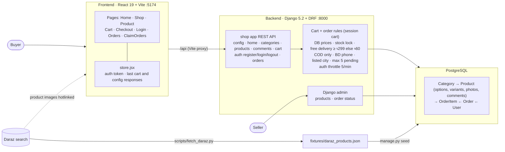

# Haat — MVP e-commerce

A simple general store for Bangladesh. React (Vite, Tailwind CSS, shadcn/ui) frontend, Django + DRF backend, PostgreSQL.
"Haat" (হাট) is the open village market; the design lays products out like goods at a haat stall.

## Features

**Buyers**
- Home page with deals, best rated products and a category menu
- Shop by category, search, and sort by price or rating
- Product pages with discount, specs, stock level, max quantity, photo gallery and related products
- Product options (e.g. Size, Color): each combination is a variant with its own stock and optional price
- Comments on product pages for signed-in buyers: one-level replies, likes, edit (marked edited), delete (kept as a placeholder when it has replies); cursor-paged
- Quick-add buttons on product tiles; out-of-stock states
- Guest session cart with totals and a free-delivery meter (free at ৳299+, else ৳60)
- Register / login with password visibility toggle; tokens expire after 30 days
- Checkout with cash on delivery, Bangladeshi phone and city validation, and the cart's items listed in the order summary; guests can order without an account
- Checkout sends the total the buyer saw; if the cart changed meanwhile (price, stock, other tab) the order is refused with what changed
- Phone numbers typed in Bengali digits (০১৭…) are accepted and stored as ASCII
- Cart auto-fixes itself (sold out, less stock, max qty) and tells the buyer why; header shows "Cart, N items"
- Payment options and their hints come from `/api/config/` (cash on delivery for now)
- Order history (own orders only) with status badges; guest orders from the same browser move to the account on login or sign-up when their phone got an earlier account order delivered, or, when their optional email is the account's, after the buyer opens the link mailed to that address
- Lucide icons, lazy-loaded routes (stale chunks after a deploy reload the page), toast messages, empty states, scroll-reveal animations, star rating labels
- Responsive product images (200/400/800px copies from the Daraz CDN)
- Every price, date, badge and label comes pre-formatted from the API (taka, Indian digit grouping); all fixed UI words (buttons, headings, aria labels) come from `shop/copy.py` via `/api/config/`, so the React app writes no copy of its own
- Safe `next` redirect after login/register

**Sellers**
- Admin dashboard: pending orders, sales today / last 30 days with a sales chart, order progress, recent orders, low stock
- Manage products (inline price/stock edits, stock filter, image preview), categories, orders
  (search by id/name/phone, bulk mark shipped/delivered/cancelled), users with their orders, API tokens
- Admin login lockout after 5 failures
- Cancelling a pending order restores stock once; cancelled orders can't be reopened; orders can't be deleted
- Live image preview when editing a product; product options, variant stock/price and extra photos inline
- Admin product saves refuse to overwrite stock sold since the page loaded
- Remove abusive comments
- `seed` command loads 47 cleaned Daraz products; `scripts/fetch_daraz.py` re-pulls them
- One owner (the only superuser), set from `backend/.env` by `sync_owner`; a second superuser is refused
- Staff page (`/admin/staff/`): add staff by email (always an invite link valid 3 days; for an existing account it sets a new password, since sign-up doesn't verify emails), tick what each may do, remove them. Anyone with "change user" can use it, but
  only hands out permissions they hold and only changes people who hold nothing more
- The owner may add or delete orders, edit their money and items, or reopen cancelled ones, after ticking a
  warning; staff never can. Deleting a pending order puts its stock back first

**Safety**
- Prices from the database, stock locked and decremented in one transaction
- Max 5 pending orders per buyer and per phone
- Login/register throttling (5/min per IP), sign-ups capped at 50/day per IP
- Tokens revoked on logout and password change
- CSRF on cart changes
- Every error returns one readable `message`
- Production hardening: HTTPS, HSTS, secure cookies, CSP, custom admin path, Redis-shared throttle counts
- Database connections are reused per worker (60s) with health checks

## Run it

```bash
# backend (Python 3.10+)
cd backend
python3 -m venv .venv && .venv/bin/pip install -r requirements.txt
export DJANGO_DEBUG=1                        # dev only; without it Django demands a real secret key
createdb haat                                # PostgreSQL; local socket by default
                                             # other DB: POSTGRES_DB/USER/PASSWORD/HOST/PORT
.venv/bin/python manage.py migrate
.venv/bin/python manage.py seed              # 47 sample products from Daraz listings
DJANGO_DEBUG=1 .venv/bin/python manage.py demo_data  # demo users, orders, comments, stock edge cases (password: see --help)
cp .env.example .env                         # then fill in OWNER_USERNAME / OWNER_EMAIL / OWNER_PASSWORD
.venv/bin/python manage.py sync_owner       # makes that account the shop's only owner (superuser)
.venv/bin/python manage.py runserver 127.0.0.1:8000

# frontend (Node 20+)
cd frontend
npm install
npm run dev -- --port 5174                   # open http://localhost:5174
```

Vite proxies `/api` to Django, so no CORS setup is needed in dev.

Demo buyer account on the dev database: `demo_buyer` / `haat-demo-2026`.

Tests: `cd backend && DJANGO_DEBUG=1 .venv/bin/python manage.py test shop`

### MCP server (AI apps)

`mcp-server/` is a third app, run next to the backend and frontend: an [MCP](https://modelcontextprotocol.io)
server (Python SDK v2) that lets a buyer's AI app (Claude Code, Claude Desktop…) shop at Haat as them.
It never touches the database; each tool is a few calls to `/api`.

```bash
cd mcp-server
uv venv --python 3.15 .venv && uv pip install --python .venv/bin/python -r requirements.txt
.venv/bin/python -m haat_mcp                  # http://127.0.0.1:8100/mcp (env vars: see .env.example)
claude mcp add --transport http haat http://127.0.0.1:8100/mcp   # then /mcp in Claude Code to sign in
```

- **Login once, required.** Every request needs a token, so even listing the tools does. On first connect the
  app opens the browser: the buyer logs in on the site (or signs up), then allows the app on `/connect`.
  Django issues the tokens (django-oauth-toolkit: dynamic client registration, PKCE, refresh tokens that
  never expire). The app stays signed in until the buyer changes their password or the app's tokens are
  deleted in admin; logging out of the website doesn't sign it out.
- **App down:** every tool answers "The Haat app is not reachable at …" instead of failing.
- AI carts live in the MCP server's memory, one per buyer, apart from the website cart; restarting it empties them.

| Tool | Does | API calls |
| --- | --- | --- |
| `store_info` | payment options, delivery cost, cities | `GET /config/` |
| `find_products` | search or browse by words, category, sort | `GET /products/` |
| `product_details` | price, options, each combination's stock, specs, latest comments | `GET /products/<slug>/`, `GET /products/<slug>/comments/` |
| `add_to_cart` | add a product with its options | `GET /products/<slug>/`, `GET /cart/` (CSRF cookie), `POST /cart/` |
| `view_cart` | items, totals, notes; its `expected_total` goes to checkout | `GET /cart/` |
| `change_cart` | set a line's quantity, 0 removes it | `PATCH` or `DELETE /cart/<item>/` |
| `checkout` | cash-on-delivery order; refused if the cart changed since `view_cart` | `GET /cart/`, `POST /orders/` |
| `my_orders` | the buyer's orders with status | `GET /orders/` |

Tests: `cd mcp-server && .venv/bin/python -m unittest discover tests` (no running app needed).

CI (`.github/workflows/ci.yml`, every push/PR): backend tests on PostgreSQL, `pip-audit`, missing-migration check;
frontend `npm audit`, lint and build.

## Architecture



```
frontend/  React 19 + react-router 7, no state library
  src/api.js         fetch wrapper, useFetch hook
  src/store.jsx      StoreProvider: auth token, the server's cart and config responses (hook: useStore.js)
  src/lib/styles.js  shared Tailwind class strings
  src/components/    one file per shared component (Header, TileGrid, Summary, Qty, Comments, Toast, ...); ui/ holds shadcn/ui
  src/pages/         Home, Shop (category/search/sort), Product, Cart, Checkout, Login, Orders, ClaimOrders (emailed link)
backend/   Django 5.2 LTS + DRF, one app: shop
  shop/models.py      Category, Product (discount, stock level, specs, rank), ProductOption, ProductVariant,
                      ProductImage, Comment, Order, OrderItem
  shop/copy.py        every fixed UI string, by page; sent as `text` in /api/config/
  shop/display.py     taka, Indian digit grouping, dates, image sizes: the API sends every string ready to print
  shop/cart.py        session cart: quantities, totals, delivery fee, free-delivery meter
  shop/auth.py        token expiry, CSRF check, client IP, login lockout
  shop/serializers.py order creation from the cart: DB prices, stock lock
  shop/api/           REST layer: catalog.py (config, home, products), checkout.py (cart, orders),
                      accounts.py (register, login, logout), errors.py (one `message` per error), urls.py
  shop/admin.py       dashboard, admin site with lockout, product/order/user admin
  shop/management/commands/seed.py  loads + cleans shop/fixtures/daraz_products.json
  scripts/fetch_daraz.py            re-pulls that fixture from Daraz search
```

| Endpoint | Method | Auth | Notes |
| --- | --- | --- | --- |
| `/api/config/` | GET | - | cities, sort options, payment options, password rules, footer copy and photo, `text` (all UI copy) |
| `/api/home/` | GET | - | wall, deals, best rated, category menu |
| `/api/products/?category=&q=&sort=` | GET | - | `{title, count_label, empty, categories, results}`; sort: `price`, `-price`, `-rating` |
| `/api/products/<slug>/` | GET | - | adds specs, stock level and label, max qty, options, variants, photos, related |
| `/api/products/<slug>/comments/` | GET, POST | POST: Token | top-level comments, cursor-paged, with reply counts |
| `/api/comments/<id>/` | PATCH, DELETE | Token | edit or delete your own comment |
| `/api/comments/<id>/replies/` | GET | - | replies to a comment |
| `/api/comments/<id>/like/` | POST | Token | toggle your like |
| `/api/cart/` | GET, POST | - | session cart with totals; POST `{product, quantity, options}` adds |
| `/api/cart/<key>/` | PATCH, DELETE | - | set `{quantity}` or remove a line (key = product + chosen options) |
| `/api/auth/register/` | POST | - | returns token, username, safe `next` path |
| `/api/auth/login/` | POST | - | returns token, username, safe `next` path; claims matching guest orders (sign-up too) |
| `/api/auth/logout/` | POST | Token | revokes the token and wipes the session (cart, guest orders) |
| `/api/orders/claim/` | POST | Token | takes the `token` from the emailed claim link; adds those guest orders if the link names this account and its email |
| `/api/orders/` | GET, POST | optional | account's orders, or a guest's orders from this session; POST (CSRF) takes the address and `expected_total`, and orders the session cart |

Every error response carries `message`: the one line the app shows. The frontend only renders: prices (`*_display`),
badges, rating labels, aria labels, image sizes (`thumb`/`image`/`image_large`), dates, totals lines and copy all come from the API.

Order rules (server side, tested): price comes from the database, never the client; stock is locked
and decremented in one transaction; delivery is free at ৳299 and above, otherwise ৳60; payment is
cash on delivery; phone must be a Bangladeshi mobile number; city must be a listed city; a buyer can
have at most 5 pending orders, and so can a phone number across all accounts and guests. Guest orders
are throttled to 30 per hour per IP, rotate the session key, and are listed only to the session that
placed them. On login or sign-up they move to the account only if they give the account's email or a phone it has
ordered to before (so a shared browser never hands one person's address to another), and the session key rotates.
If checkout's `expected_total` no longer matches the server total, the order is refused. Product price is at
least ৳1. Deleting a user keeps their orders (user set to null). Login and register are
throttled to 5 per minute per IP, and sign-ups to 50 per day per IP. Login tokens expire after 30 days and
are revoked on logout and on any password change. Cart changes need Django's CSRF token (the frontend
reads it from the `csrftoken` cookie that `GET /api/cart/` sets).

Sellers manage products and order status in Django admin (`/admin`, or `DJANGO_ADMIN_PATH`). Admin login
needs the account's email and password; 5 failures lock that IP and that username out for 15 minutes. Orders can't be deleted
or have items edited in admin: cancel them instead, which puts the stock back.

## Production settings

Leave `DJANGO_DEBUG` unset. Then you must set `DJANGO_SECRET_KEY` (Django refuses to start without it),
and HTTPS redirect, HSTS and secure cookies turn on.

| Env var | Purpose |
| --- | --- |
| `DJANGO_SECRET_KEY` | long random value, e.g. `python -c "import secrets; print(secrets.token_urlsafe(50))"` |
| `DJANGO_ALLOWED_HOSTS` | comma-separated hostnames |
| `DJANGO_ADMIN_PATH` | non-default admin path, e.g. `seller-x7k2/` |
| `REDIS_URL` | e.g. `redis://localhost:6379/0`; required with more than one worker, so throttle and lockout counts are shared |
| `EMAIL_HOST`, `EMAIL_PORT`, `EMAIL_HOST_USER`, `EMAIL_HOST_PASSWORD`, `EMAIL_USE_TLS`, `DEFAULT_FROM_EMAIL` | SMTP for the guest-order claim links (dev prints mail to the console) |
| `DJANGO_NUM_PROXIES` | number of reverse proxies in front of Django (throttling uses the real client IP); above 0 also trusts the proxy's `X-Forwarded-Proto` for HTTPS |
| `MCP_RESOURCE_URL` | the MCP server's public address, e.g. `https://mcp.example.com/mcp`; set the same value in the MCP server's env, with `HAAT_URL` (the site) and `HAAT_API` |

Run `manage.py collectstatic` (into `backend/staticfiles/`) so the admin has its CSS, and run
`manage.py clearsessions` daily (cron): every guest who fills a cart leaves a session row.

Also:
- Serve the frontend, `/api` and `/.well-known/oauth-authorization-server` from one origin, and have the proxy pass the browser's `Host` header to
  Django (nginx: `proxy_set_header Host $host;`). The CSRF check compares it with `Origin`.
- The built `index.html` carries a Content-Security-Policy. Headers that a `<meta>` tag can't set must come
  from the web server serving the frontend: `Content-Security-Policy: frame-ancestors 'none'`,
  `Strict-Transport-Security`, `X-Content-Type-Options: nosniff`, `Referrer-Policy: same-origin`.
- Restrict the admin path by IP at the proxy if you can.
- Logs (errors, admin login failures and lockouts, guest order ids with IP, no personal data) go to stdout.
- Not done yet: phone OTP at checkout. The per-phone cap slows hoarding with fake orders, but anyone can
  type a made-up number; add an SMS gateway before scaling.

## Not in the MVP

Online payment (bKash/SSLCommerz), star reviews from buyers, product list pagination, order emails/SMS,
returns, seller accounts. Product images are hotlinked from Daraz's CDN and listings copied from
Daraz for demo only: replace them with your own before any public launch.
