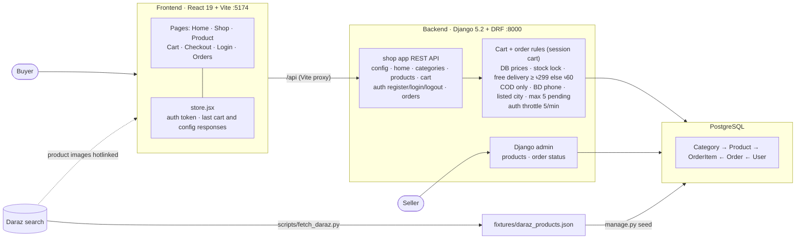

# Haat — MVP e-commerce

A simple general store for Bangladesh. React (Vite) frontend, Django + DRF backend, PostgreSQL.
"Haat" (হাট) is the open village market; the design lays products out like goods at a haat stall.

## Features

**Buyers**
- Home page with deals, best rated products and a category menu
- Shop by category, search, and sort by price or rating
- Product pages with discount, specs, stock level, max quantity and related products
- Quick-add buttons on product tiles; out-of-stock states
- Guest session cart with totals and a free-delivery meter (free at ৳299+, else ৳60)
- Register / login with password visibility toggle; tokens expire after 30 days
- Checkout with cash on delivery, Bangladeshi phone and city validation
- Order history (own orders only)

**Sellers**
- Admin dashboard: pending orders, sales today / last 30 days, recent orders, low stock
- Manage products (inline price/stock edits, stock filter, image preview), categories, orders
  (search by id/name/phone, bulk mark shipped/delivered/cancelled), users with their orders, API tokens, 2FA devices
- Admin 2FA (authenticator app) with lockout after 5 failures
- Cancelling an order restores stock

**Safety**
- Prices from the database, stock locked per order
- Max 5 pending orders per buyer and per phone
- Login/register throttling, CSRF on cart changes
- Production hardening: HTTPS, HSTS, secure cookies, CSP

## Run it

```bash
# backend (Python 3.10+)
cd backend
python3 -m venv .venv && .venv/bin/pip install -r requirements.txt
export DJANGO_DEBUG=1                        # dev only; without it Django demands a real secret key
createdb haat                                # PostgreSQL; local socket by default
                                             # other DB: POSTGRES_DB/USER/PASSWORD/HOST/PORT
.venv/bin/python manage.py migrate
.venv/bin/python manage.py seed              # 47 sample products from Daraz listings
.venv/bin/python manage.py createsuperuser   # for /admin
.venv/bin/python manage.py admin_totp <username>  # admin needs an authenticator-app code; scan the printed URL
.venv/bin/python manage.py runserver 127.0.0.1:8000

# frontend (Node 20+)
cd frontend
npm install
npm run dev -- --port 5174                   # open http://localhost:5174
```

Vite proxies `/api` to Django, so no CORS setup is needed in dev.

Demo buyer account on the dev database: `demo_buyer` / `haat-demo-2026`.

Tests: `cd backend && DJANGO_DEBUG=1 .venv/bin/python manage.py test shop`

## Architecture



```
frontend/  React 19 + react-router 7, no state library
  src/api.js         fetch wrapper, useFetch hook
  src/store.jsx      StoreProvider: auth token, the server's cart and config responses (hook: useStore.js)
  src/components/    one file per shared component (Header, TileGrid, Summary, Qty, Footer, Status, Toast, ...)
  src/pages/         Home, Shop (category/search/sort), Product, Cart, Checkout, Login, Orders
backend/   Django 5.2 LTS + DRF, one app: shop
  shop/models.py      Category, Product (discount, stock level, specs, rank), Order, OrderItem
  shop/display.py     taka, Indian digit grouping, dates, image sizes: the API sends every string ready to print
  shop/cart.py        session cart: quantities, totals, delivery fee, free-delivery meter
  shop/auth.py        token expiry, CSRF check, client IP, login lockout
  shop/serializers.py order creation from the cart: DB prices, stock lock
  shop/api/           REST layer: catalog.py (config, home, products), checkout.py (cart, orders),
                      accounts.py (register, login, logout), errors.py (one `message` per error), urls.py
  shop/admin.py       dashboard, 2FA admin site, product/order/user admin
  shop/management/commands/seed.py  loads + cleans shop/fixtures/daraz_products.json
  scripts/fetch_daraz.py            re-pulls that fixture from Daraz search
```

| Endpoint | Method | Auth | Notes |
| --- | --- | --- | --- |
| `/api/config/` | GET | - | cities, sort options, password rules, footer copy and photo |
| `/api/home/` | GET | - | wall, deals, best rated, category menu |
| `/api/products/?category=&q=&sort=` | GET | - | `{title, count_label, empty, categories, results}`; sort: `price`, `-price`, `-rating` |
| `/api/products/<slug>/` | GET | - | adds specs, stock level and label, max qty, related |
| `/api/cart/` | GET, POST | - | session cart with totals; POST `{product, quantity}` adds |
| `/api/cart/<id>/` | PATCH, DELETE | - | set `{quantity}` or remove a line |
| `/api/auth/register/` | POST | - | returns token, username, safe `next` path |
| `/api/auth/login/` | POST | - | returns token, username, safe `next` path |
| `/api/auth/logout/` | POST | Token | revokes the token |
| `/api/orders/` | GET, POST | Token | own orders only; POST takes the address and orders the session cart |

Every error response carries `message`: the one line the app shows. The frontend only renders: prices (`*_display`),
badges, rating labels, image sizes (`thumb`/`image`/`image_large`), dates, totals lines and copy all come from the API.

Order rules (server side, tested): price comes from the database, never the client; stock is locked
and decremented in one transaction; delivery is free at ৳299 and above, otherwise ৳60; payment is
cash on delivery; phone must be a Bangladeshi mobile number; city must be a listed city; a buyer can
have at most 5 pending orders, and so can a phone number across all accounts. Login and register are
throttled to 5 per minute per IP, and sign-ups to 50 per day per IP. Login tokens expire after 30 days and
are revoked on logout and on any password change. Cart changes need Django's CSRF token (the frontend
reads it from the `csrftoken` cookie that `GET /api/cart/` sets).

Sellers manage products and order status in Django admin (`/admin`, or `DJANGO_ADMIN_PATH`). Admin login
needs the password plus an authenticator code (log in with the password first, then pick the device and
enter the code); 5 failures lock that IP and that username out for 15 minutes. Orders can't be deleted
or have items edited in admin: cancel them instead, which puts the stock back. Lost phone:
`manage.py admin_totp <username> --reset`.

## Production settings

Leave `DJANGO_DEBUG` unset. Then you must set `DJANGO_SECRET_KEY` (Django refuses to start without it),
and HTTPS redirect, HSTS and secure cookies turn on.

| Env var | Purpose |
| --- | --- |
| `DJANGO_SECRET_KEY` | long random value, e.g. `python -c "import secrets; print(secrets.token_urlsafe(50))"` |
| `DJANGO_ALLOWED_HOSTS` | comma-separated hostnames |
| `DJANGO_ADMIN_PATH` | non-default admin path, e.g. `seller-x7k2/` |
| `REDIS_URL` | e.g. `redis://localhost:6379/0`; required with more than one worker, so throttle and lockout counts are shared |
| `DJANGO_NUM_PROXIES` | number of reverse proxies in front of Django (throttling uses the real client IP); above 0 also trusts the proxy's `X-Forwarded-Proto` for HTTPS |

Run `manage.py collectstatic` (into `backend/staticfiles/`) so the admin has its CSS, and run
`manage.py clearsessions` daily (cron): every guest who fills a cart leaves a session row.

Also:
- Serve the frontend and `/api` from one origin, and have the proxy pass the browser's `Host` header to
  Django (nginx: `proxy_set_header Host $host;`). The CSRF check compares it with `Origin`.
- The built `index.html` carries a Content-Security-Policy. Headers that a `<meta>` tag can't set must come
  from the web server serving the frontend: `Content-Security-Policy: frame-ancestors 'none'`,
  `Strict-Transport-Security`, `X-Content-Type-Options: nosniff`, `Referrer-Policy: same-origin`.
- Restrict the admin path by IP at the proxy if you can.
- Logs (errors, admin login failures and lockouts) go to stdout.
- Not done yet: phone OTP at checkout. The per-phone cap slows hoarding with fake orders, but anyone can
  type a made-up number; add an SMS gateway before scaling.

## Not in the MVP

Online payment (bKash/SSLCommerz), product variants, reviews, pagination, order emails/SMS,
returns, seller accounts. Product images are hotlinked from Daraz's CDN and listings copied from
Daraz for demo only: replace them with your own before any public launch.
