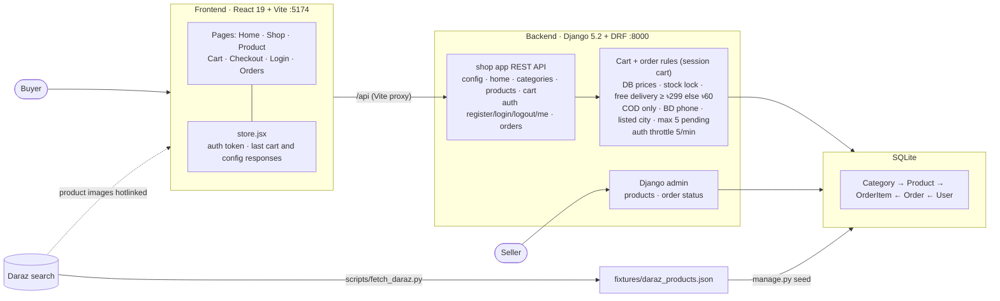

# Haat — MVP e-commerce

A simple general store for Bangladesh. React (Vite) frontend, Django + DRF backend, SQLite.
"Haat" (হাট) is the open village market; the design lays products out like goods at a haat stall.

## Run it

```bash
# backend (Python 3.10+)
cd backend
python3 -m venv .venv && .venv/bin/pip install -r requirements.txt
export DJANGO_DEBUG=1                        # dev only; without it Django demands a real secret key
.venv/bin/python manage.py migrate
.venv/bin/python manage.py seed              # 47 sample products from Daraz listings
.venv/bin/python manage.py createsuperuser   # for /admin
.venv/bin/python manage.py runserver 127.0.0.1:8000

# frontend (Node 20+)
cd frontend
npm install
npm run dev -- --port 5174                   # open http://localhost:5174
```

Vite proxies `/api` to Django, so no CORS setup is needed in dev.

Demo buyer account on the dev database: `demo_buyer` / `haat-demo-2026`.

Tests: `cd backend && DJANGO_DEBUG=1 .venv/bin/python manage.py test shop`

## Architecture



```
frontend/  React 19 + react-router 7, no state library
  src/api.js         fetch wrapper, taka formatting, Daraz image resize
  src/store.jsx      auth token; holds the server's cart and config responses
  src/components.jsx header, footer, product tile, delivery meter, qty stepper
  src/pages/         Home, Shop (category/search/sort), Product, Cart, Checkout, Login, Orders
backend/   Django 5.2 LTS + DRF, one app: shop
  shop/models.py      Category, Product (discount, stock level, specs, rank), Order, OrderItem
  shop/cart.py        session cart: quantities, totals, delivery fee, free-delivery meter
  shop/serializers.py order creation from the cart: DB prices, stock lock
  shop/views.py       REST endpoints
  shop/management/commands/seed.py  loads + cleans shop/fixtures/daraz_products.json
  scripts/fetch_daraz.py            re-pulls that fixture from Daraz search
```

| Endpoint | Method | Auth | Notes |
| --- | --- | --- | --- |
| `/api/config/` | GET | - | free-delivery threshold, fee, cities, sort options |
| `/api/home/` | GET | - | wall, deals, best rated, category menu |
| `/api/categories/` | GET | - | |
| `/api/products/?category=&q=&sort=` | GET | - | sort: `price`, `-price`, `-rating` |
| `/api/products/<slug>/` | GET | - | adds specs, stock level, max qty, related |
| `/api/cart/` | GET, POST | - | session cart with totals; POST `{product, quantity}` adds |
| `/api/cart/<id>/` | PATCH, DELETE | - | set `{quantity}` or remove a line |
| `/api/auth/register/` | POST | - | returns token |
| `/api/auth/login/` | POST | - | returns token, username |
| `/api/auth/logout/` | POST | Token | revokes the token |
| `/api/auth/me/` | GET | Token | |
| `/api/orders/` | GET, POST | Token | own orders only; POST takes the address and orders the session cart |

Order rules (server side, tested): price comes from the database, never the client; stock is locked
and decremented in one transaction; delivery is free at ৳299 and above, otherwise ৳60; payment is
cash on delivery; phone must be a Bangladeshi mobile number; city must be a listed city; a buyer can
have at most 5 pending orders. Login and register are throttled to 5 per minute per IP.

Sellers manage products and order status in Django admin (`/admin`, or `DJANGO_ADMIN_PATH`).

## Production settings

Leave `DJANGO_DEBUG` unset. Then you must set `DJANGO_SECRET_KEY` (Django refuses to start without it),
and HTTPS redirect, HSTS and secure cookies turn on.

| Env var | Purpose |
| --- | --- |
| `DJANGO_SECRET_KEY` | long random value, e.g. `python -c "import secrets; print(secrets.token_urlsafe(50))"` |
| `DJANGO_ALLOWED_HOSTS` | comma-separated hostnames |
| `DJANGO_ADMIN_PATH` | non-default admin path, e.g. `seller-x7k2/` |
| `DJANGO_NUM_PROXIES` | number of reverse proxies in front of Django (throttling uses the real client IP) |

Also: serve the frontend and `/api` from one origin, send a Content-Security-Policy header from the web
server, restrict the admin path by IP at the proxy, and use a shared cache (Redis) if you run more than
one worker, so throttle counts are shared.

## Research that shaped it

- **Cartup**: header with search, flash deals, category grid; free delivery over a threshold; COD + bKash/Nagad.
- **Daraz**: product card = image, name, sale price, struck original, discount %.
- **Chaldal**: delivery fee rules shown up front, "pay after receiving". Became the cart's delivery meter.
- **Pickaboo**: COD as a first-class payment option.

## Not in the MVP

Online payment (bKash/SSLCommerz), product variants, reviews, pagination, order emails/SMS,
returns, seller accounts. Product images are hotlinked from Daraz's CDN and listings copied from
Daraz for demo only: replace them with your own before any public launch.
